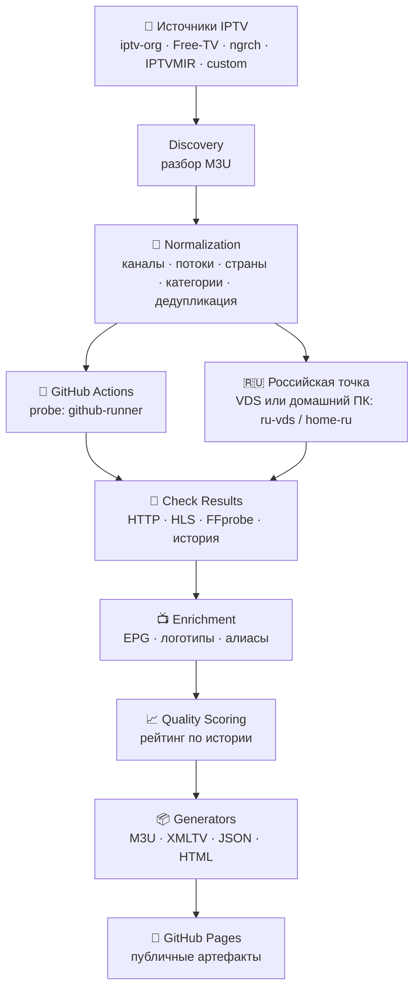

<div align="center">

# 📺 iptv-ru-monitor

**Автоматизированный мониторинг публичных IPTV-потоков и каталог каналов для Android TV / TiviMate**

🇷🇺 Первая страна — Россия · Другие страны добавляются конфигурацией, без правки кода

[](https://github.com/chelslava/iptv-ru-monitor/actions/workflows/ci.yml)


</div>

---

> [!WARNING]
> **Что это НЕ.** Проект — инструмент мониторинга и каталогизации, а не поставщик
> телевизионных услуг. Он не обходит DRM, авторизацию, платные подписки или
> геоблокировки и не предназначен для поиска и распространения нелегальных копий
> платных каналов. Успешный HTTP-ответ не считается доказательством
> воспроизводимости. Источники с неясными правами не включаются в публичные
> сборки до проверки — см. [docs/SOURCE_POLICY.md](docs/SOURCE_POLICY.md);
> merge PR с кандидатами фиксирует выполнение правового чек-листа.

> [!NOTE]
> Количество каналов — не показатель качества. Приоритет у проверяемости,
> стабильности, корректного EPG и допустимости источника.

## ✨ Возможности

| | |
|---|---|
| 🔎 **Discovery** | Сбор каналов из открытых источников: IPTV-org, Free-TV/IPTV, ngrch, IPTVMIR и любые M3U-списки (адаптер `remote_m3u`) |
| 🧹 **Normalization** | Канонические названия, категории; страна определяется по `tvg-id` и названию, а не наследуется от источника; канал отделён от потока |
| 🔬 **Многоуровневые проверки** | HTTP/DNS/TLS → HLS (playlist + первый сегмент) → FFprobe (кодеки, разрешение, битрейт) → ограниченное декодирование |
| 🌍 **Географический контекст** | Результаты маркируются точкой наблюдения: `github-runner`, `ru-vds`, `home-ru` — доступность из РФ не смешивается с зарубежной |
| 📈 **Скоринг по истории** | Рейтинг строится по повторным проверкам; новым потокам присваивается `insufficient_data`, а не завышенный балл |
| 📺 **EPG и логотипы** | Сопоставление XMLTV по `tvg-id`, ручным алиасам и нормализованным названиям; ручные совпадения не перезаписываются |
| 🛡 **Безопасная публикация** | Секретные URL и токены не попадают в артефакты и логи; SSRF-защита при проверках сторонних URL; публикация — через подтверждение (PR с кандидатами) |
| 📦 **Артефакты** | M3U для TiviMate, XMLTV, JSON-каталоги, отчёт с причинами включения/исключения |

## 🚀 Быстрый старт

Требуется [uv](https://docs.astral.sh/uv/) (или Python 3.12+):

```bash
uv sync --extra dev          # окружение и зависимости
uv run iptv-monitor --help   # список команд
uv run iptv-monitor pipeline --country RU   # полный цикл
```

Отдельные этапы:

```bash
uv run iptv-monitor discover                    # сбор и нормализация источников
uv run iptv-monitor check --levels http,hls     # проверка потоков
uv run iptv-monitor enrich                      # EPG и логотипы
uv run iptv-monitor score                       # рейтинг по истории
uv run iptv-monitor build --country RU          # генерация dist/
```

<details>
<summary>🐳 Через Docker</summary>

```bash
docker compose up --build monitor        # полный цикл
docker compose run --rm monitor check    # отдельный этап
```
</details>

<details>
<summary>🖥 Российская точка наблюдения с домашнего ПК (без VDS)</summary>

Разовый прогон сценария VDS (метка `ru-vds`, отдельный файл результатов):

```bash
bash scripts/run_vds_check_local.sh     # уровни http,hls, 5 потоков
IPTV_LIMIT=20 IPTV_LEVELS=http,hls,ffprobe bash scripts/run_vds_check_local.sh
```

Постоянная RU-точка — ночной прогон с резидентного IP (метка `home-ru`,
~300 потоков с ротацией по каталогу — полный круг за ~30 ночей, публикация
результатов в ветку `probe/ru`):

```bash
bash scripts/ru_probe_push.sh           # вручную; либо по расписанию
IPTV_LIMIT=500 IPTV_ROTATE_PARTS=15 bash scripts/ru_probe_push.sh
```

Результаты подключаются к сборке так же, как артефакт реального VDS.
Подробнее: [deploy/vds/README.md](deploy/vds/README.md).
</details>

## 📊 Как это работает



<details>
<summary>Уровни проверки потоков</summary>

| Уровень | Что проверяется | Зачем |
|---|---|---|
| **1. HTTP** | DNS, TCP, TLS, коды ответа, редиректы, размер | Быстро отсеять мёртвые URL |
| **2. HLS** | Master/media playlist, варианты качества, первый сегмент | URL отвечает ≠ поток играет |
| **3. Медиа** | FFprobe: кодеки, разрешение, FPS, битрейт | Параметры качества и профили отбора |
| **4. Повторяемость** | Повторные проверки с интервалом, точка наблюдения | Один успех не доказывает стабильность |

</details>

<details>
<summary>Рейтинг качества (стартовая гипотеза)</summary>

| Компонент | Вес |
|---|---|
| Доступность при повторных проверках | 35 % |
| Устойчивость получения сегментов | 30 % |
| Время запуска | 15 % |
| Медиапараметры | 15 % |
| Корректность HLS | 5 % |

Уровни: `90–100 excellent` · `75–89 good` · `50–74 unstable` · `0–49 failed`.
Меньше `min_checks` проверок → `insufficient_data` (в плейлисты не попадает).
Калибровка — [docs/QUALITY_SCORING.md](docs/QUALITY_SCORING.md).
</details>

## ⚙️ Конфигурация

| Файл | Назначение |
|---|---|
| [`config/app.yaml`](config/app.yaml) | Тайм-ауты, параллелизм, хранилище, ретенция |
| [`config/sources.yaml`](config/sources.yaml) | Источники и политика публикации (`allow` / `review` / `deny`) |
| [`config/countries/ru.yaml`](config/countries/ru.yaml) | Профиль страны: плейлисты, EPG-алиасы |
| [`config/quality_profiles.yaml`](config/quality_profiles.yaml) | Веса рейтинга и профили отбора (`ru_default`, `ru_hd`, `ru_kids`, `ru_sport`) |
| [`config/epg_sources.yaml`](config/epg_sources.yaml) | Источники XMLTV |
| [`config/logo_sources.yaml`](config/logo_sources.yaml) | Источники логотипов |
| [`.env.example`](.env.example) | Переопределения окружением (`IPTV_*`) |

Новая страна = новый файл `config/countries/<код>.yaml` — логика стран не
зашита в код.

## 📦 Артефакты

```
dist/
├── index.html            # страница со ссылками
└── ru/
    ├── russia.m3u        # основной плейлист (TiviMate и др.)
    ├── russia-hd.m3u     # ≥ 720p
    ├── russia-kids.m3u   # детские
    ├── russia-sport.m3u  # спортивные
    ├── russia.xml        # XMLTV EPG (согласованные tvg-id)
    ├── channels.json     # нормализованный каталог каналов
    ├── streams.json      # публичные сведения о потоках (без секретов)
    ├── stats.json        # сводные счётчики и время последней проверки точек
    └── report.json       # причины включения/исключения каждого потока + uptime
```

`dist/` генерируется автоматически и вручную не редактируется.

## 🔌 Данные/API

Все артефакты — машиночитаемый JSON, доступен без авторизации:

| Файл | Содержимое |
|---|---|
| [`stats.json`](https://chelslava.github.io/iptv-ru-monitor/ru/stats.json) | счётчики каталога/плейлиста, покрытие EPG, автодeny, последнее время проверки каждой точки наблюдения |
| [`report.json`](https://chelslava.github.io/iptv-ru-monitor/ru/report.json) | по каждому потоку: score, уровень, причины исключения, uptime 7д/30д, провалы подряд |
| [`channels.json`](https://chelslava.github.io/iptv-ru-monitor/ru/channels.json) | каталог каналов (имена, tvg-id, логотипы, категории, страна) |
| [`streams.json`](https://chelslava.github.io/iptv-ru-monitor/ru/streams.json) | потоки и решения публикации (URL — только без секретов) |

## 📺 Подключение в TiviMate (Android TV)

1. Дождитесь публикации артефактов (workflow `publish-pages.yml`).
2. TiviMate → *Настройки → Плейлисты → Добавить плейлист → URL*:
   `https://<аккаунт>.github.io/iptv-ru-monitor/ru/russia.m3u`
3. Источник EPG: `.../ru/russia.xml` (генерируется из epg.pw, см.
   `config/epg_sources.yaml`).
4. Тематические подборки: `russia-hd.m3u`, `russia-kids.m3u`, `russia-sport.m3u`.

Локально: соберите плейлист командой `uv run iptv-monitor build` и укажите
в TiviMate файл `dist/ru/russia.m3u`.

## 🧪 Тестирование и качество

```bash
uv run pytest            # unit + integration, без обращения к сети
uv run ruff check .      # линтер
uv run mypy              # типизация
```

Интеграционный тест прогоняет весь конвейер на мок-транспорте: discovery →
проверки → скоринг → сборка, включая проверку исключения секретных URL.

## 🗺️ Roadmap

- [x] **Этап 0** — репозиторий, Python-проект, CI, схемы данных
- [x] **Этап 1** — MVP Discovery: адаптер iptv-org, нормализация, дедупликация
- [x] **Этап 2** — проверки потоков: HTTP/HLS/FFprobe, классификация ошибок
- [x] **Этап 3** — инфраструктура РФ-точки: Docker-окружение VDS, скрипты, слияние результатов *(полная проверка — на реальном VDS)*
- [x] **Этап 4** — EPG и логотипы: XMLTV, tvg-id, алиасы, отчёт о покрытии *(источники включаются после проверки лицензий)*
- [x] **Этап 5** — рейтинг и плейлисты: профили качества, M3U/XMLTV, автоподготовка кандидатов на публикацию (PR от `approve-candidates`)
- [ ] **Этап 6** — вторая страна (профиль `config/countries/<код>.yaml`); GitHub Pages уже опубликован

## 📚 Документация

| Документ | Содержание |
|---|---|
| [docs/ARCHITECTURE.md](docs/ARCHITECTURE.md) | Полная архитектура проекта |
| [docs/DATA_MODEL.md](docs/DATA_MODEL.md) | Модель данных и файлы состояния |
| [docs/QUALITY_SCORING.md](docs/QUALITY_SCORING.md) | Формулы рейтинга и калибровка |
| [docs/SOURCE_POLICY.md](docs/SOURCE_POLICY.md) | Реестр источников и правила публикации |
| [docs/OPERATIONS.md](docs/OPERATIONS.md) | Локальный запуск, CI/CD, VDS, ретенция |

## 🤝 Участие и безопасность

- [CONTRIBUTING.md](CONTRIBUTING.md) — как предложить изменения.
- [SECURITY.md](SECURITY.md) — модель угроз и как сообщить об уязвимости.
- [CODE_OF_CONDUCT.md](CODE_OF_CONDUCT.md) — правила поведения.

## 📄 Лицензия

Код распространяется по лицензии [MIT](LICENSE). Лицензия проекта **не
распространяется** автоматически на потоки, EPG, логотипы и сторонние каталоги.

**Благодарности:** [iptv-org/iptv](https://github.com/iptv-org/iptv) и
[Free-TV/IPTV](https://github.com/free-tv/iptv) — открытые каталоги, используемые
как источники данных (в рамках их условий).

---

<div align="center">
<sub>Сделано для сообщества · Мониторинг вместо обещаний: каждый поток в плейлисте проверен</sub>
</div>
